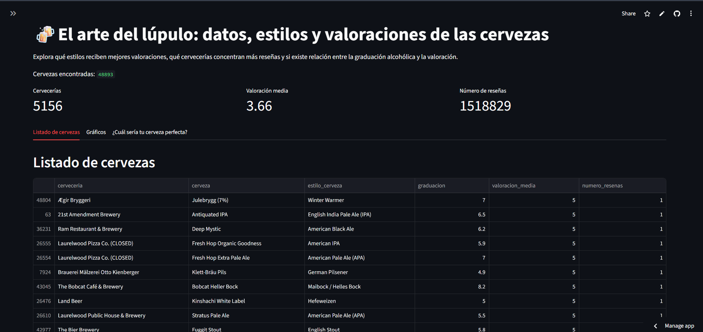
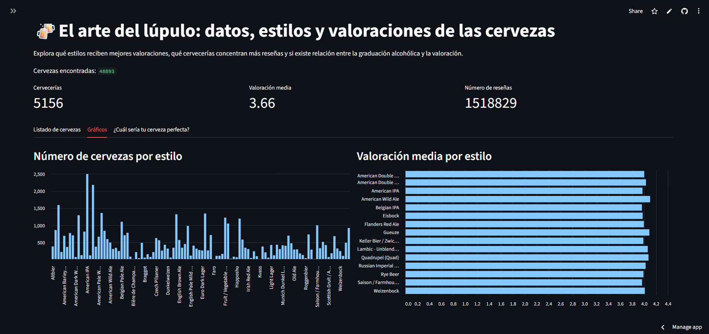
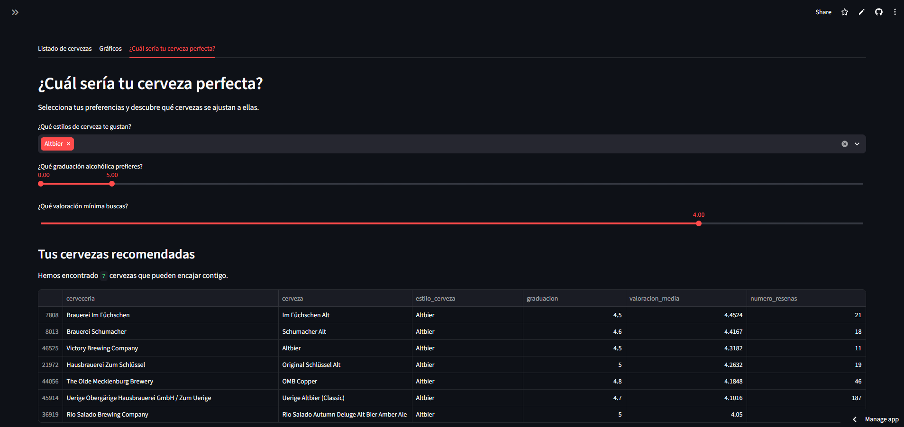

# El arte del lúpulo: datos, estilos y valoraciones de las cervezas

Proyecto de análisis exploratorio de datos con Python para descubrir qué estilos de cerveza reciben mejores valoraciones, qué cervecerías acumulan más reseñas y qué relación existe entre la graduación alcohólica y las puntuaciones. Dirigido a aficionados a la cerveza y a quienes quieran explorar sus características y valoraciones.

## La pregunta

¿Qué podemos descubrir sobre las cervezas a partir de las reseñas de miles de consumidores?

Para responderlo, investigaré tres cuestiones:

1. ¿Qué estilos de cerveza reciben mejores valoraciones?
2. ¿Qué cervecerías concentran un mayor número de reseñas?
3. ¿Existe una relación entre la graduación alcohólica y la valoración de una cerveza?

## Los datos

- De dónde salen: [Beer Reviews – Kaggle](https://www.kaggle.com/datasets/rdoume/beerreviews)
- Cuántos son: 1.586.614 filas y 13 columnas en el conjunto original. Después de la limpieza, 1.518.829 filas y 5 columnas.
- Qué es cada fila: una reseña individual de una cerveza. Una misma cerveza puede aparecer en varias filas porque puede tener múltiples valoraciones.

## Qué he limpiado y por qué

- He seleccionado cinco columnas relevantes para el análisis: cervecería, valoración, estilo de cerveza, nombre de la cerveza y graduación alcohólica.
- He traducido los nombres de las columnas al español para facilitar su comprensión.
- He eliminado 67.785 filas que no contenían información sobre la graduación alcohólica, ya que necesitaba esta variable para estudiar su relación con las valoraciones.
- He conservado las 15 filas que no contenían información sobre la cervecería, identificando esos valores como "Desconocida".
- He conservado las valoraciones iguales a cero porque no hay información suficiente para considerarlas errores.
- He mantenido las filas coincidentes porque no puedo confirmar que sean reseñas duplicadas.

## Lo que he encontrado

1. Valoraciones por estilo: American Wild Ale obtiene la valoración media más alta, con 4,10 sobre 5. Le siguen Gueuze (4,09) y Quadrupel (4,07). En el extremo opuesto, Low Alcohol Beer obtiene la media más baja, con 2,55.

2. Cervecerías con más reseñas: Boston Beer Company (Samuel Adams) encabeza la lista con 38.812 reseñas. Le siguen Dogfish Head Brewery (33.800) y Stone Brewing Co. (33.022).

3. Relación entre graduación y valoración: la correlación de Pearson es de 0,14 cuando se calcula por reseña y de 0,19 cuando se calcula por cerveza. Ambas indican una relación positiva muy débil. Aunque se observa una ligera tendencia a que las cervezas con mayor graduación reciban mejores valoraciones, no podemos afirmar que una mayor graduación implique una mejor puntuación.

## La app

La aplicación permite explorar el conjunto de datos de cervezas mediante distintos filtros: estilo, graduación alcohólica, valoración mínima y nombre de la cerveza.

Los resultados se muestran en tres pestañas:
- **Listado:** permite consultar las cervezas que cumplen los filtros seleccionados.
- **Gráficos:** muestra información visual sobre las cervezas encontradas y sus valoraciones medias por estilo.
- **Cerveza perfecta:** permite seleccionar preferencias de estilo, graduación y valoración mínima para obtener recomendaciones. Solo se recomiendan cervezas con al menos 10 reseñas, para evitar resultados poco representativos.

Enlace: [Streamlit Community Cloud](https://arte-lupulo.streamlit.app/)

## Cómo ejecutarlo

1. Crear un entorno e instalar las librerías: `pip install -r requirements.txt`
2. El EDA está en `eda.ipynb`.
3. La app se abre con `streamlit run app.py`.

## Presentación del proyecto

Puedes consultar la presentación completa del proyecto en PDF:

[El arte del lúpulo – Presentación](presentacion/lupulo.pdf)

## Autor

Erika Pinel Ortega 👽

- GitHub: [@eripinor](https://github.com/eripinor)
- LinkedIn: [erika-pinel](https://www.linkedin.com/in/erika-pinel/)